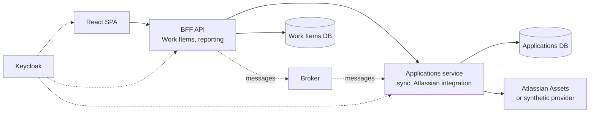

# Learning roadmap

OpsPortal is a project-based curriculum. Each phase delivers working software and targets specific skills from the [skill map](mentoring/skills.md). The [mentoring profile](mentoring/ops-portal.md) describes how lessons, hints, and checkpoints work.

## Cadence

- **Sessions:** Tuesday and Thursday evenings, plus one weekend session (day varies). About 8 to 12 hours a week; plans assume 8.
- **Sprints:** two weeks, Tuesday through the second weekend. Each sprint is a GitHub milestone.
- **Estimates:** every issue gets an estimate before work starts and an actual time when it closes.
- **Retro:** the last weekend session of each sprint reviews estimates against actuals, assistance metrics, and the skill map, then plans the next sprint.

## Timeline

| Sprint | Dates | Phase |
|---|---|---|
| S1 | Dec 1 – Dec 13, 2026 | 0. Restart |
| S2–S3 | Dec 15, 2026 – Jan 10, 2027 | 1. Frontend catch-up |
| S4 | Jan 12 – Jan 24 | 2. Data and reporting |
| S5 | Jan 26 – Feb 7 | 3. Modular monolith |
| S6–S7 | Feb 9 – Mar 7 | 4. Extract the Applications service |
| S8–S9 | Mar 9 – Apr 4 | 5. Write-back over messaging |
| S10–S11 | Apr 6 – May 2 | 6. Ship |
| S12 | May 4 – May 16 | Buffer |

S2 and S3 span the holidays and carry less scope.

## 0. Restart

Get back to a working environment, measure where things stand, and put tracking in place.

- Complete first-clone setup ([#8](https://github.com/ingenite/ops-portal/issues/8)).
- Improve PowerShell helpers ([#5](https://github.com/ingenite/ops-portal/issues/5)), including a `Get-AssistanceReport` function that reads commit trailers and reports the assistance metrics.
- Baseline assessment: explain existing code without notes, and confirm or correct the skill map.
- Create GitHub milestones S1–S12 and an estimate field on the project board.

**Done when:** a clean clone reaches a running app in under 30 minutes using only the README, the skill map is confirmed, and the S1 retro reports assistance metrics.

**Skills:** PowerShell toolmaking, Git log parsing, estimating.
**Solo milestone:** `Get-AssistanceReport`.

## 1. Frontend catch-up

Bring the SPA up to what the API already supports.

- Add an Applications view and application selection on create ([#10](https://github.com/ingenite/ops-portal/issues/10)).
- Make controls reflect Reader and Admin permissions ([#9](https://github.com/ingenite/ops-portal/issues/9)).
- Add client-side routing as the views grow.
- Review usability, accessibility, and responsive layout ([#11](https://github.com/ingenite/ops-portal/issues/11)) using hand-written CSS; no component library yet.

**Done when:** the Applications view shows stored records with their last sync time, work items can be created with an application, Reader sessions show no mutation controls, layouts work at phone width and by keyboard alone, and component tests cover the new views.

**Skills:** client-side routing, CSS layout, accessibility, forms, TypeScript.
**Solo milestone:** [#9](https://github.com/ingenite/ops-portal/issues/9).

## 2. Data and reporting

Close the provider read gap and write a report that answers a real question.

- Follow provider pagination during import.
- Add a local synthetic-data provider mode ([#7](https://github.com/ingenite/ops-portal/issues/7)). Later phases and the public demo depend on it.
- Add one report, such as work item status by application, and justify any index with a query plan.

**Done when:** imports read every provider page, the app runs end to end without Atlassian credentials, and the new report has API and component tests.

**Skills:** HTTP pagination, LINQ projections, indexes and query plans.
**Solo milestone:** the new report, end to end.

## 3. Modular monolith

Draw service boundaries inside one process before splitting into separate processes.

- Write ADR 0002: the motivation (learning service design), the chosen seam, data ownership, and what the split costs.
- Separate Work Items and Applications into modules that interact only through defined interfaces.
- Replace the cross-module foreign key with a reference by ID, validated through the Applications module.

**Done when:** ADR 0002 is accepted, modules share no data access, and existing tests pass.

**Skills:** writing ADRs, service decomposition, data ownership.
**Solo milestone:** ADR 0002, written by the user and then reviewed.

## 4. Extract the Applications service

Move Applications and synchronization into their own service.

- Create an ASP.NET Core service that owns application data, the Atlassian integration, and the sync worker.
- The existing API remains the browser-facing BFF and calls the service through a typed client with timeouts and retries.
- Authenticate service-to-service calls with Keycloak client credentials.
- Orchestrate local development with Aspire (formerly .NET Aspire).

**Done when:** the SPA behaves as before, the whole system starts with one command, a trace follows a request from the BFF into the service, and contract tests cover the service API.

**Skills:** service contracts, resilience, service-to-service auth, distributed tracing.
**Open questions:** a database per service or a schema per service; whether Work Items looks up applications on demand or keeps a local copy; whether the sync lock stays single-instance (document it) or becomes a database lease.

## 5. Write-back over messaging

Accept an update through the API, persist the request, and process it in the background against the provider.

- Use an outbox so a request and its message are saved together.
- Use a message broker between services. RabbitMQ is the candidate; a SQL-backed queue remains an option. Record the choice in ADR 0003.
- Make consumers idempotent, retry failures, and preserve the requesting user's identity. Decide when authorization is checked for queued work.
- Show operation status in the UI: accepted, running, failed, and reconciled with the local copy.
- Prevent an older sync snapshot from overwriting newer local changes, accounting for providers that are slow to reflect writes.

**Done when:** a fake update overlapping a sync has a predictable outcome, the UI shows accurate status, and a retry or restart neither loses the request nor applies it twice.

**Skills:** messaging, idempotency, optimistic concurrency, transactions.
**Solo milestone:** the idempotent consumer.

## 6. Ship

Run a tagged release somewhere other people can reach it.

- Build container images for the SPA, BFF, and Applications service.
- Deploy to a dedicated home host on an isolated network, behind a cloud reverse proxy with TLS.
- Run SQL Server integration tests in CI with Testcontainers.
- Add health checks and structured logging, and keep tracing in deployment.
- Tag releases and keep a changelog.
- Update the README overview and architecture ([#12](https://github.com/ingenite/ops-portal/issues/12)), then define and build the public walkthrough ([#13](https://github.com/ingenite/ops-portal/issues/13), [#14](https://github.com/ingenite/ops-portal/issues/14)).

**Done when:** a tagged release runs on the home host with synthetic data, CI tests against SQL Server, and the README describes the current architecture.

**Skills:** containers, deployment, observability, release management.

## Target architecture

- React owns interaction, presentation, and UI state.
- The BFF validates browser requests and enforces user authorization ([ADR 0001](adr/0001-use-a-backend-for-frontend.md)).
- Each service owns its data. Other services reach it only through the owner's API or messages.
- Provider-specific code stays inside the Applications service.

Moving to services is an intentional architectural study. ADR 0002 records it; update the boundary guidance in `AGENTS.md` when it is accepted.

## Completed (Aug – Nov 2026)

| Milestone | Known limits |
|---|---|
| Work Items API, SQL Server persistence, React SPA, status report | — |
| Atlassian Assets read through a server-side client | Reads one bounded page |
| Synchronized local copy of applications | Records absent from later responses are kept; tests use SQLite |
| Background sync with overlap protection and failure recovery | Overlap protection works within one process only |
| Keycloak sign-in, JWT bearer auth, Reader/Admin policies | Integration tests substitute test auth for real token validation |
| CI, analyzers, vulnerability fixes, .NET 11 | — |

Git history before this revision has the detailed write-ups.

## Adding to the roadmap

Proposals are welcome at any time.

1. Open an issue with the `proposal` label.
2. At the next sprint planning, accept it into a phase, park it under Later topics, or close it.
3. Accepting a proposal into a phase either moves dates or displaces other scope; say which. The buffer absorbs up to one sprint.
4. Change dates only at a retro, and record the change below.

## Later topics

- Configurable Atlassian attribute mappings ([#6](https://github.com/ingenite/ops-portal/issues/6)).
- Summary cards and charts.
- A UI component library such as MUI.

## Project boundary

Use personal development environments and fake data. Employer systems, data, credentials, and business logic stay outside OpsPortal.

## Revisions

| Date | Change |
|---|---|
| 2026-11-25 | Rewrote as a dated curriculum; added the microservices phases |
